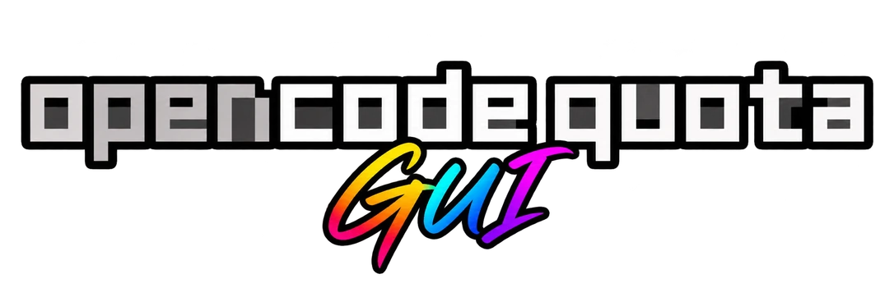
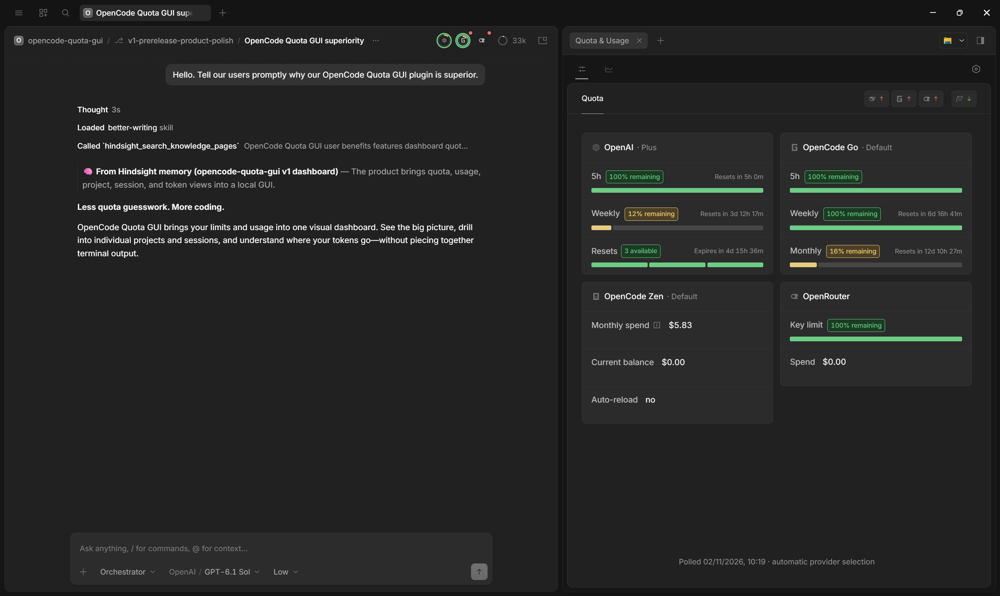
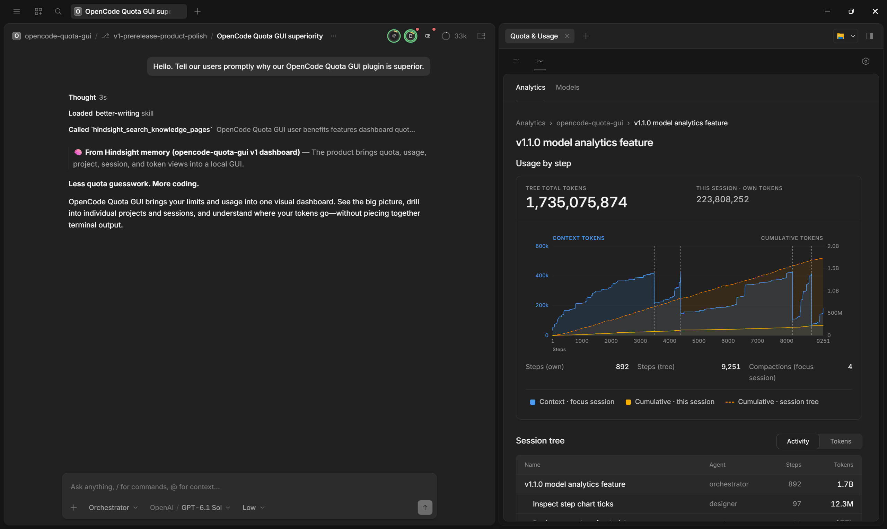
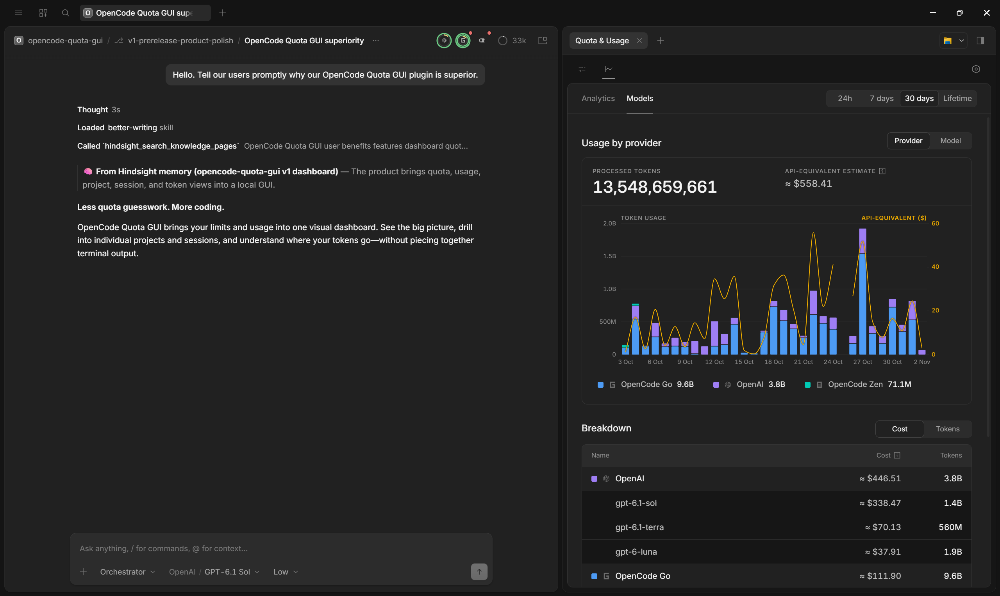
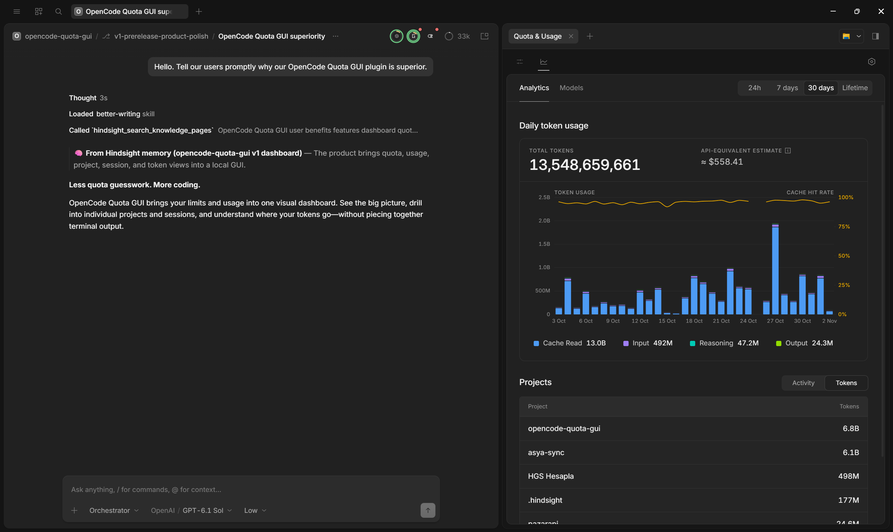
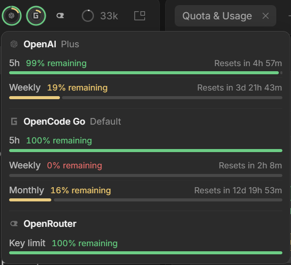

<p align="center">
  
</p>

# OpenCode Quota GUI

Quota, token usage, and analytics inside OpenCode Desktop. OpenCode Quota GUI adds a native side panel, a session-header quota slot, and native notifications to OpenCode. Everything is read and shown locally: there is no hosted service, no cloud account, and no remote usage store.

<p align="center">
  <a href="https://www.npmjs.com/package/opencode-quota-gui"></a>
  <a href="./LICENSE"></a>
</p>

## Native OpenCode Desktop

The Native panel is the primary experience in **v1.3.0**. Open **Quota & Usage** for Quota, Analytics, Models, and their detail pages; OpenCode Settings includes the plugin's **Quota & analytics** page. The session header shows a compact quota slot with a combined preview.

The Native integration ships from **v1.3.0** and requires **OpenCode Desktop 2.2.0 or newer**.

<p align="center">
  
</p>

<table>
  <tr>
    <td width="50%" valign="top">
      
      <br />
      <sub><strong>Session analytics</strong> — per-session and whole-tree usage, compaction markers, and the session tree.</sub>
    </td>
    <td width="50%" valign="top">
      
      <br />
      <sub><strong>Models by provider</strong> — token and API-equivalent cost breakdown by provider and model.</sub>
    </td>
  </tr>
  <tr>
    <td width="50%" valign="top">
      
      <br />
      <sub><strong>Daily analytics</strong> — daily token usage, cache hit rate, and project totals.</sub>
    </td>
    <td width="50%" valign="top">
      
      <br />
      <sub><strong>Header Slot</strong> — at-a-glance quota rings with the combined preview open.</sub>
    </td>
  </tr>
</table>

## What you get

The Native panel is the primary surface in v1.3.0. Every feature below is available there, and the optional browser dashboard mirrors the same views as a fallback.

## Features

- **Native panel:** Quota, Analytics, Models, and Settings live in OpenCode Desktop, with project, session, provider, and model drilldowns in the same side panel.
- **Header quota slot:** compact rings for quota windows with a stable identity, plus a combined preview of every visible provider and account.
- **Native notifications:** low quota, exhausted quota, quota reset, and provider or API failures. A focused window shows an in-app toast; a background window asks OpenCode to notify you. Set the low-quota threshold and duplicate cooldown in Settings.
- **Quota by provider account:** provider logos with plan, account, or workspace labels, and one card per signed-in account, seat, API key, or workspace. Multiple logins for one provider each get their own card. Cards show the quota and rate-limit windows, reset countdowns, and balance, spend, budget, or status rows the integration supports. OpenAI cards can add banked resets and credits; Cursor and Alibaba can estimate from local history; the active login is marked `(active)`.
- **Peak and off-peak pricing:** for providers whose published rules define time-of-day pricing, the Quota header shows **Peak**, **Off-peak**, or **Mixed** with the next change, a per-model schedule in your local time, and holiday exceptions. Model detail pages split each provider route's historical tokens and API-equivalent cost into Peak and Off-peak rows.
- **Analytics:** token usage over `24h`, `7d`, `30d`, or `lifetime`; a stacked daily token chart for cache read, input, reasoning, and output; a cache hit rate line; and projects you can sort by activity or tokens.
- **Models:** stacked token charts grouped by provider or model, with an API-equivalent cost line and a sortable cost/token breakdown. Open a provider to see its models or a model to see its providers.
- **Drilldowns:** Analytics → project → session, and Models → provider or model, with working back navigation.
- **Session detail:** per-step context and cumulative own-session and whole-tree token charts, compaction markers, and a nested session tree with steps and totals.
- **API-equivalent estimates:** list-price estimates for recorded tokens, using the peak or off-peak rate that applied when each step completed, shown beside token totals in Analytics, Models, projects, providers, and models. They are estimates, not subscription spend.
- **Customization:** used or remaining percentages, label style, row detail, provider selection, refresh interval, request timeout, card order, per-card or per-row visibility, and which providers show peak and off-peak status. Custom quota providers and pricing fallbacks live in the canonical config.
- **Local-first operation:** no cloud account and no hosted sync; the plugin reads OpenCode data on this machine. The optional browser dashboard binds only to `127.0.0.1`. Reset-aware retry can hold a request until the provider's used-up quota window resets; turn it off with `waitForQuotaReset: false`.

## Quick start

Install the plugin through OpenCode:

```bash
opencode plugin add opencode-quota-gui
```

That adds this entry to your OpenCode configuration, keeping the other plugins that are already there:

```jsonc
{
  "$schema": "https://opencode.ai/config.json",
  "plugins": ["opencode-quota-gui"],
}
```

OpenCode installs the configured npm plugin itself; you do not need a separate `npm install`. If you prefer to edit the config manually, add the same `opencode-quota-gui` entry to the plural `plugins` array in `~/.config/opencode/opencode.json(c)` or a project `opencode.json(c)`.

Then open **Quota & Usage** in OpenCode Desktop. The Native panel is available from **v1.3.0** and requires **OpenCode Desktop 2.2.0 or newer**.

The browser dashboard default follows the OpenCode host version. On hosts below **2.2.0**, it is on by default because the Native panel is unavailable there; at **2.2.0 or newer** it is off by default. An explicit `dashboard.enabled` value in the canonical settings always wins. When it runs, it is served on `127.0.0.1` at `dashboard.port` (default `4144`). To pin the behavior either way, edit the canonical settings file and restart OpenCode:

```jsonc
{
  "dashboard": {
    "enabled": true,
    "port": 4144
  }
}
```

`true` forces web access on and `false` keeps it off. Then open <http://localhost:4144/quota>. The first page may show an empty dashboard until OpenCode has loaded the plugin and discovered a provider account. The path and platform overrides are in [Configuration](docs/readme/configuration.md#web-dashboard).

Requirements: OpenCode `>= 2.0.16 < 2.3.0` and Node.js `22.13+` or `23.4+`. The Native Desktop integration ships from v1.3.0 and requires OpenCode Desktop 2.2.0+. This package does not support OpenCode 1.

## Native panel

In OpenCode Desktop 2.2.0+, **Quota & Usage** opens the product in the side panel, and OpenCode Settings includes the plugin's **Quota & analytics** page. The session header shows compact quota rings; select the slot for the combined preview.

- **Quota:** cards for discovered provider accounts, ordered and grouped by provider. Each card shows the provider mark, plan and account or workspace labels, the rows the integration supports, a compact percentage bar for percentage rows, reset countdowns, and card-local errors. OpenAI cards can include banked resets and credits. Multiple logins for one provider get their own cards, and the active login is marked `(active)`. For providers with time-based pricing, the header shows live peak and off-peak status; open a status for its schedule, next change, and holiday exceptions.
- **Analytics:** total tokens and API-equivalent estimate for the selected range, a stacked token chart with cache hit rate, and projects ordered by activity or tokens. Open a project for its own token chart, worktree label, and root sessions.
- **Models:** token usage and API-equivalent cost grouped by provider or model. Use the Provider/Model switch and sort the breakdown by cost or tokens. Provider and model rows open their own detail pages.
- **Session:** the opened session and its descendants, with per-step context and cumulative token charts, own-session and whole-tree totals, compaction markers, and a session-tree table.
- **Settings:** display, provider, request, temporal pricing, visibility, and card-order controls, plus the web dashboard switch, the canonical settings file, any reported configuration issues, and build information.

The panel follows you between sessions: switching sessions reuses the same shared quota and analytics state instead of starting over, and header quota indicators stay in place across OpenCode Desktop's normal dashboard watch rotations.

Native notifications cover low quota, exhausted quota, quota reset, and provider or API failures. The low-quota threshold and duplicate cooldown are configurable in Settings. A focused window shows an in-app toast; a background window asks OpenCode to notify you. Delivery is best effort, not exactly once.

## Optional browser dashboard

The browser dashboard is a fallback for browser access, not the primary surface. Its default follows the OpenCode host version: on hosts below **2.2.0** it is on by default, because the Native panel requires 2.2.0 or newer; at **2.2.0 or newer** it is off by default. An explicit `dashboard.enabled: true` or `false` in the canonical settings always wins. When it runs, it is served on `127.0.0.1` at the fixed `dashboard.port` (default `4144`) only. It does not listen on network interfaces, does not fall back to another port, and has no cloud component. Local port forwarding, proxy configuration, or another process running on the same machine is outside this guarantee.

The browser view exposes the same product areas:

- **Quota:** provider account cards with the same rows, labels, reset countdowns, and peak and off-peak status as the Native panel.
- **Analytics:** total tokens and API-equivalent estimate for the selected range, a stacked token chart with cache hit rate, and projects ordered by activity or tokens.
- **Models:** token usage and API-equivalent cost grouped by provider or model, with detail pages for each.
- **Session:** the opened session and its descendants, with per-step context and cumulative token charts, own-session and whole-tree totals, compaction markers, and a session-tree table.
- **Settings:** the same shared settings form and canonical settings file information.

The routes are real URLs, so reload and browser back/forward work:

- `/quota` — provider account cards
- `/analytics?range=7d` — token usage and projects
- `/models?range=30d` — usage grouped by provider; add `&group=model` for model grouping
- `/project/<id>?range=30d` — one project and its sessions
- `/session/<id>` — one session tree
- `/settings` — dashboard settings

## Scope and limitations

- **Tokens are not quota.** Quota cards show provider-reported quota, rate-limit, balance, spend, budget, or status values, plus documented local estimates for some providers. Analytics shows token activity recorded by OpenCode on this machine. A token total does not measure remaining quota, and a quota reset does not clear token history. Provider quota can include usage from outside OpenCode, while local analytics cannot see that usage.
- **Cost estimates are not bills.** The API-equivalent figure applies list prices to recorded tokens. It is not subscription spend, an invoice, or a reconciliation of what a provider charged; plan pricing, credits, discounts, taxes, and provider billing adjustments are not applied.
- **`Free`, `Unpriced`, and unknown tokens are distinct.** `Free` appears only for a non-empty total whose every token has an explicit zero list price. Unpriced or unknown tokens are excluded from the estimate; a mixed total is marked `Partial estimate`, and a non-empty total with no priced tokens is `Unpriced`, never `Free` or `USD 0`. A model with a missing or unrecognized identity or price can make a total partial or unpriced.
- **Coverage is local and provider-limited.** Analytics covers completed steps in the local OpenCode database; other machines, other clients, deleted sessions, and activity not recorded as completed steps are absent. Historical provider/model attribution depends on the raw identities OpenCode stored. Provider coverage and plan support vary: some APIs expose only balance, spend, budget, or status, and a card cannot invent quota that the provider does not return. Cursor and Alibaba cards that use local history are estimates, not official provider totals.
- **Native and browser surfaces.** The Native panel requires OpenCode Desktop 2.2.0+ and ships from v1.3.0. The optional browser dashboard binds to `127.0.0.1`; it is not a hosted service, and the package has no TUI.

## Providers

Most providers work automatically once you log in through OpenCode. A **Needs setup** link points to the extra step. Provider data is collected by the plugin inside the OpenCode host; the plugin does not run a separate polling service. Quota cards use provider marks and plan, account, or workspace labels; each signed-in account, seat, API key, or workspace gets its own card, and the active login is marked `(active)`. OpenCode Console workspace display names refresh automatically.

### Pre-configured American providers

<details open>
<summary><strong>Personal</strong></summary>

| Provider           | Auth/setup                                                     | Data from          | Reports            |
| ------------------ | -------------------------------------------------------------- | ------------------ | ------------------ |
| Anthropic (Claude) | [Needs setup](docs/readme/providers.md#anthropic-claude)       | Local CLI/OAuth    | Quota              |
| Chutes AI          | Automatic                                                      | Remote API         | Quota              |
| Cursor             | [Needs setup](docs/readme/providers.md#cursor)                 | Local estimate     | Budget and spend   |
| GitHub Copilot     | Automatic                                                      | Remote API         | Budget and usage   |
| Google AGY         | [Needs setup](docs/readme/providers.md#google-agy-quick-setup) | Remote API         | Quota              |
| Kilo Gateway       | Automatic                                                      | Remote API         | Quota and balance  |
| NanoGPT            | Automatic                                                      | Remote API         | Quota and balance  |
| Ollama Cloud       | Automatic                                                      | Remote API         | Quota and balance  |
| OpenAI             | Automatic                                                      | Remote API         | Quota              |
| OpenCode Go        | Automatic                                                      | Remote API         | Quota              |
| OpenCode Zen       | Automatic                                                      | Remote API         | Budget and balance |
| OpenRouter         | Automatic                                                      | Remote API         | Key limit + spend  |
| Synthetic          | Automatic                                                      | Remote API         | Quota              |
| xAI SuperGrok      | Automatic                                                      | Remote API         | Quota              |

</details>

<details>
<summary><strong>Business / Enterprise</strong></summary>

| Provider                | Auth/setup                                                     | Data from          | Reports            |
| ----------------------- | -------------------------------------------------------------- | ------------------ | ------------------ |
| Anthropic (Claude)      | [Needs setup](docs/readme/providers.md#anthropic-claude)       | Local CLI/OAuth    | Quota              |
| Chutes AI               | Automatic                                                      | Remote API         | Quota              |
| Cursor                  | [Needs setup](docs/readme/providers.md#cursor)                 | Local estimate     | Budget and spend   |
| Gemini CLI              | [Needs setup](docs/readme/providers.md#gemini-cli)             | Remote API         | Quota              |
| GitHub Copilot          | [Needs setup](docs/readme/providers.md#github-copilot)         | Remote API         | Budget and usage   |
| Google AGY              | [Needs setup](docs/readme/providers.md#google-agy-quick-setup) | Remote API         | Quota              |
| NanoGPT                 | Automatic                                                      | Remote API         | Quota and balance  |
| OpenAI                  | Automatic                                                      | Remote API         | Quota              |
| OpenCode Zen            | Automatic                                                      | Remote API         | Budget and balance |
| OpenRouter              | Automatic                                                      | Remote API         | Key limit + spend  |
| Synthetic               | Automatic                                                      | Remote API         | Quota              |
| xAI SuperGrok           | Automatic                                                      | Remote API         | Quota              |

Gemini CLI works only with Gemini Code Assist Standard or Enterprise (organization) accounts. Personal Google users should use Google AGY.

</details>

### Pre-configured Chinese providers

<details open>
<summary><strong>Personal</strong></summary>

| Provider                      | Auth/setup                                                                   | Data from      | Reports            |
| ----------------------------- | ---------------------------------------------------------------------------- | -------------- | ------------------ |
| Alibaba Coding Plan           | Automatic                                                                    | Local estimate | Quota              |
| Alibaba Personal Token Plan   | [Needs setup](docs/readme/providers.md#alibaba-personal-token-plan)          | Official CLI   | Quota              |
| DeepSeek                      | Automatic                                                                    | Remote API     | Balance and status |
| Kimi Code                     | Automatic                                                                    | Remote API     | Quota              |
| Kimi Code (CN)                | Automatic                                                                    | Remote API     | Quota              |
| MiniMax Token Plan            | Automatic                                                                    | Remote API     | Quota              |
| MiniMax Token Plan (CN)       | Automatic                                                                    | Remote API     | Quota              |
| Xiaomi MiMo                   | [Needs setup](docs/readme/providers.md#xiaomi-mimo)                          | Dashboard API  | Quota and balance  |
| Z.ai Coding Plan              | Automatic                                                                    | Remote API     | Quota              |
| Zhipu Coding Plan             | Automatic                                                                    | Remote API     | Quota              |

</details>

<details>
<summary><strong>Business / Team</strong></summary>

| Provider                 | Auth/setup | Data from  | Reports |
| ------------------------ | ---------- | ---------- | ------- |
| Kimi Code                | Automatic  | Remote API | Quota   |
| Kimi Code (CN)           | Automatic  | Remote API | Quota   |
| MiniMax Token Plan       | Automatic  | Remote API | Quota   |
| MiniMax Token Plan (CN)  | Automatic  | Remote API | Quota   |
| Zhipu Coding Plan        | Automatic  | Remote API | Quota   |

These show only your own member API key's usage, not the whole organization's.

</details>

### Custom providers

A custom provider can read a supported quota API or estimate usage from your local OpenCode history. Define it in the global canonical settings file under `quotaProviders`; see the [custom-provider guide](docs/readme/providers.md#custom-providers) for the complete schema, adapter rules, and security limits. The Native Settings page does not create provider definitions.

## Settings and privacy

The plugin reads only the canonical file at runtime:

```text
~/.config/opencode/opencode-quota-gui/config.jsonc
```

`$XDG_CONFIG_HOME/opencode` replaces `~/.config/opencode` when `XDG_CONFIG_HOME` is set, and `OPENCODE_CONFIG_DIR` replaces the global OpenCode config folder. The sibling `config.json` is not read, converted, or imported; it is preserved unchanged. Changes made in `Settings` write to this canonical file. Settings values, source labels, the port, and visibility lists come only from the canonical file and defaults, regardless of whether OpenCode uses `opencode.json` or `opencode.jsonc`. Selecting a project install in `init` adds only the project OpenCode plugin entry; behavior settings remain global. Inherited legacy values are available only through the separate import preview.

- **Legacy import:** when a global legacy OpenCode Quota source exists, Settings can preview and copy seven compatible keys: `percentDisplayMode`, `percentLabelStyle`, `enabledProviders`, `minIntervalMs`, `requestTimeoutMs`, `accountingDetail`, and `waitForQuotaReset`. The import is read-only for the source; files stay byte-for-byte untouched. Custom provider definitions are not imported, so copy `quotaProviders` into the canonical file yourself.
- **Visibility:** hiding a provider or row is presentation only and never changes polling or provider data. Opaque card and row IDs in `dashboard.hiddenCards` and `dashboard.hiddenRows` are internal identifiers: use **Settings → Visibility** to manage them instead of editing or deriving IDs by hand.
- **Temporal pricing:** `dashboard.temporalProviderOverrides` stores sparse per-provider on/off choices for the live peak and off-peak status in the Quota header. A provider with a discovered account is shown by default; an explicit choice wins. Hiding a status is presentation only and never changes polling, quota values, or recorded usage.
- **Web dashboard (optional fallback):** on by default below OpenCode 2.2.0 and off by default at 2.2.0 and newer. An explicit `"dashboard": { "enabled": true }` or `"dashboard": { "enabled": false }` in the canonical file always wins. When enabled, the browser UI is served on `127.0.0.1` at `dashboard.port` (default `4144`), and the server never falls back to another port. Changes apply after an OpenCode restart.
- **Browser storage:** the dashboard uses browser-local storage for display state such as the selected range and a visibility-catalog cache. It does not use cross-site cookies.
- **Local data:** the plugin reads OpenCode's local configuration and login data through OpenCode, plus OpenCode's local session database for usage and session views. Provider quota checks use the provider's API or the documented local CLI or companion plugin. Token pricing can come from the bundled snapshot or `models.dev` at runtime. Peak and off-peak rules ship in the bundled snapshot and are evaluated locally.
- **OpenTelemetry (optional):** off by default. Set `"telemetry": { "enabled": true }` in the canonical file to publish two gauges, `opencode.quota.consumed` and `opencode.quota.cache.age`, through the `@opentelemetry/api` global `MeterProvider` that your host process configures. The plugin does not create a `MeterProvider`, exporter, collector, or metrics endpoint, sends no metrics by itself, and makes no extra provider requests for telemetry. Metric names and attributes are not a public API. See [External integration](docs/readme/external-integration.md#optional-opentelemetry-advanced-host-owned).
- **No hosted service:** this project has no cloud account, hosted dashboard, or remote usage store. The local server permits only loopback hosts and origins and sends no CORS headers.
- **Build details:** Settings → About reports the embedded Version, Build, and Contract. A build or contract mismatch means the page and server plugin are from different builds; restart OpenCode, then reload the page. Reinstall the same package if it persists.

See [Configuration](docs/readme/configuration.md) for every supported settings key and the custom-provider rules.

## Installing and updating

The normal install is the [Quick start](#quick-start) plugin entry. To update, let OpenCode resolve the same `opencode-quota-gui` entry again, then restart OpenCode. If you pin a version in `plugins`, update that version explicitly.

Optional maintenance commands are available for people who want a previewed config or cache cleanup:

```bash
npx opencode-quota-gui init --dry-run
npx opencode-quota-gui update --dry-run
npx opencode-quota-gui update --yes
```

`init` and `update` are maintenance only: `init` is a guided setup for the plugin entry, canonical GUI settings, and the OpenCode config location, and it is not required. `update` previews safe plugin-entry and package-cache maintenance; it does not install or upgrade the npm package for you. Neither command queries providers, displays quota, or produces a report, and neither reads or prints credential values.

For a local build or release candidate, build the checkout and point the optional `OPENCODE_QUOTA_PLUGIN_SPEC` override at the absolute `file:` URL of the packed artifact before running `init`. Local plugin entries and release tarballs are documented in [Manual install](docs/readme/manual-install.md). Update behavior and rollback notes are in [Updating safely](docs/readme/updating.md).

## OpenCode and upstream compatibility

This project has no TUI panel, terminal quota interface or reports, slash command, tool, report hook, or status line, and it produces no report message, marker, or metadata contract. The `init` and `update` commands described above are maintenance only, not a quota interface. The server plugin owns dashboard data, credentials, and reset-retry lifecycle; its dashboard RPC supports the Native Desktop GUI.

It is independent of the upstream `@slkiser/opencode-quota` package. The two packages may be configured at the same time, and there is no dependency or conflict guard between them. Each owns its configuration and private state; this package writes under the `opencode-quota-gui` namespace and does not migrate, rewrite, or delete upstream configuration, cache, or credential files.

The browser dashboard default follows the OpenCode host version: it is on by default below 2.2.0, where the Native panel does not exist, and off by default at 2.2.0 and newer. An explicit `dashboard.enabled` value in the canonical settings always wins. Either way, the server stays loopback-only on `127.0.0.1`.

Use the upstream project if you want its terminal surfaces. Use this project if you want quota and usage inside OpenCode Desktop. See [Updating safely](docs/readme/updating.md) for migration and coexistence details.

## Support

- [Manual install](docs/readme/manual-install.md)
- [Configuration](docs/readme/configuration.md)
- [Providers](docs/readme/providers.md)
- [Troubleshooting](docs/readme/troubleshooting.md)
- [External integration](docs/readme/external-integration.md)
- [Updating safely](docs/readme/updating.md)
- [Open a bug or feature request](https://github.com/PVLPM/opencode-quota-gui/issues)

When reporting a problem, include your OpenCode version and the Version, Build, and Contract shown in Settings → About. Do not paste credentials, tokens, private paths, or raw provider responses.

Outside references: [OpenCode v2 docs](https://opencode.ai/v2/docs/) · [OpenCode v2 config](https://opencode.ai/v2/docs/config/) · [OpenCode v2 plugins](https://opencode.ai/v2/docs/plugins/) · [models.dev pricing data](https://models.dev/) · [Node.js downloads](https://nodejs.org/en/download)

## Contributing

Contributions are welcome. Read [CONTRIBUTING.md](CONTRIBUTING.md) before opening an issue or pull request. In short: open an issue first, run `pnpm verify`, keep the fix focused, and include before-and-after screenshots for any visible change. Credentials, account identifiers, and private paths must be redacted.

## Acknowledgements and license

This project is MIT-licensed and is derived from the upstream [opencode-quota](https://github.com/slkiser/opencode-quota) project (MIT). Upstream history, copyright, and license notices are preserved. It is not built by the OpenCode team and is not affiliated with OpenCode or any provider listed above.

Provider names and plan names belong to their owners. Pricing data is provided by [models.dev](https://models.dev/). See [LICENSE](LICENSE) for the full text.

## Contributors

Thanks to everyone who has contributed to this repository.

<a href="https://github.com/PVLPM/opencode-quota-gui/graphs/contributors">
  
</a>

## Star history

[](https://www.star-history.com/#PVLPM/opencode-quota-gui&Date)
